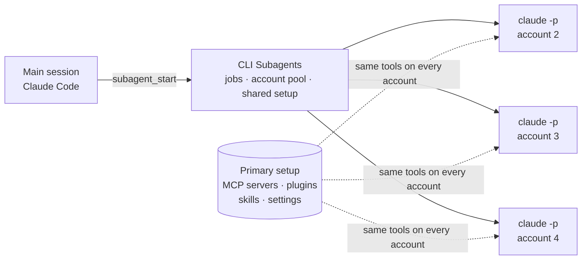

# CLI Subagents

Let your coding agent hand work to the other agent CLIs you already have, each running in its own harness under your own login, with one shared setup across all your accounts.

[](LICENSE)


CLI Subagents is a Claude Code plugin and MCP server. Your main session starts subagents as separate `claude -p` processes, each on one of your accounts. The main session hands over a task and keeps working, and the subagent's result comes back when it's done.

Nothing in between translates one vendor's API into another's, and the tool never reads or forwards login tokens. Every model call comes from the vendor's own unmodified CLI, the same as if you had opened a terminal and typed the task yourself.



## What it does

- Runs subagents in the background. Jobs live on disk, survive restarts, and can be checked, awaited or cancelled.
- Keeps one setup across accounts. MCP servers, plugins, skills, agents, `CLAUDE.md` and settings are defined once in your normal Claude Code folder, and every account sees exactly that. Only the login is per account.
- Spreads work across accounts. Each run reports the account's 5-hour and weekly usage; new jobs go to the account with the most room, and an account that hits its limit sits out until its reset time.
- Fails over when you want it to. With `failover = "on-limit"`, a job that hits a limit continues on the next account with its partial output attached.
- Keeps the vendor's safety checks. `read` jobs run in plan mode and `edit` jobs in Claude Code's auto mode, where its own classifier reviews risky actions. Skipping permissions is an explicit per-job choice.
- Isolates workers from the host. Host-session variables (account IDs, gateway URLs, API keys) are stripped, so a worker can only ever use its own account's login.
- Needs nothing extra. It's pure Python standard library, with its own small MCP server.

## Status

| Runtime | State | Notes |
|---|---|---|
| Claude Code (`claude -p`) | Works, v0.1 | Account pool, shared setup, failover, plugin. Tested on Windows |
| Codex (`codex exec`) | In progress | Same account model through `CODEX_HOME` |
| Antigravity CLI (`agy`) | Works on Windows, separate | Standalone [adapter](adapters/antigravity/) with its own command reviewer; joins the core next |
| Cursor, Gemini CLI, Copilot, OpenCode, others | Researched | See the [CLI comparison](docs/research/cli-permissions-and-headless.md) |

## Quick start (Claude Code)

Install the package (Python 3.11+, no dependencies):

```bash
pipx install git+https://github.com/lunati228/CLI-Subagents
```

Add the plugin in Claude Code:

```text
/plugin install cli-subagents --marketplace lunati228/CLI-Subagents
```

Add each extra account and log in through Claude Code's own login:

```bash
csa accounts add max-2
csa accounts add max-3
```

Check that every account is logged in and loads the same setup:

```bash
csa doctor --live
```

Then ask your main session to delegate, or use `/cli-subagents:delegate <task>`. The full guide, including what is shared and how failover works, is in [docs/claude-code.md](docs/claude-code.md).

## How the shared setup works

Separate config folders per account (`CLAUDE_CONFIG_DIR`) keep logins apart. They also split everything else, so MCP servers, plugins and skills drift apart and you end up maintaining several copies.

CLI Subagents treats your normal Claude Code folder as the one primary setup. Before each run it links your skills, agents and commands into the account's folder and copies `CLAUDE.md`. Your settings, MCP servers and installed plugins go to the worker as launch flags. Nothing that holds a login is ever read, copied or shared.

After a run, the worker's startup event says exactly which MCP servers, plugins, skills and agents it loaded. `csa doctor --live` compares that across accounts.

Two things belong to each account on Anthropic's side and can't be shared: claude.ai connectors, and browser logins for remote MCP servers. The [guide](docs/claude-code.md#what-every-account-shares) shows how to handle both.

## Responsible use

Running the vendor's own CLI keeps authentication where the vendor put it, but each vendor's terms still apply to how you use your accounts. Sources are in [provider terms](docs/research/provider-terms.md).

- Anthropic documents one config folder per account for staying signed in to several accounts. Its terms assume "ordinary, individual usage" and say nothing explicit about rotating accounts to get past a limit. Failover is off by default; if you turn it on, you are making that call under your own accounts' terms.
- OpenAI publishes its own Claude Code → Codex integration, a strong precedent for native delegation. Its terms bar circumventing rate limits, so failover between Codex accounts stays off unless you turn it on.
- Google's Antigravity FAQ says consumer plans don't support wrapping `agy` in third-party coding agents or automating account rotation.

## Repository layout

```text
src/cli_subagents/      Core: jobs, account pool, shared setup, MCP server, csa CLI
  runtimes/claude.py    Claude Code adapter
.claude-plugin/         Plugin manifest and marketplace entry
skills/cli-subagents/   Usage skill for the host agent
commands/               /cli-subagents:delegate
tests/                  Unit and end-to-end tests with a fake claude binary
adapters/antigravity/   Standalone Antigravity MCP server and command reviewer
docs/                   Guides, design and research
```

## Documentation

| Document | Contents |
|---|---|
| [Claude Code guide](docs/claude-code.md) | Install, accounts, what is shared, failover, troubleshooting |
| [Configuration](docs/configuration.md) | `config.toml`, files, environment |
| [Design](docs/design.md) | Architecture, decisions and what was verified |
| [CLI comparison](docs/research/cli-permissions-and-headless.md) | Which CLIs have built-in auto-review, hooks and headless output |
| [Prior art](docs/research/prior-art.md) | How existing multi-CLI tools are built |
| [Claude Code as a worker](docs/research/claude-code-headless.md) | Config folders, auth, MCP, rate-limit signals |
| [Several Claude accounts](docs/research/claude-multi-account.md) | Existing tools, terms, risk |
| [Several Codex accounts](docs/research/codex-multi-account.md) | `CODEX_HOME`, sharing, rate-limit signals |
| [Provider terms](docs/research/provider-terms.md) | What each vendor says about this kind of use |

## Contributing

Issues and pull requests are welcome. Run the tests before sending a change:

```bash
python -m unittest discover -s tests -t tests
```

Set `PYTHONPATH` to `src` (or install with `pip install -e .`) first. The Antigravity adapter has its own suite in `adapters/antigravity/tests`.

New runtime adapters should keep the vendor's binary unmodified, leave authentication to it, and default to its safer permission mode.

## License and credit

Created by [lunati](https://github.com/lunati228). Licensed under [Apache-2.0](LICENSE). If you redistribute it or build on it, keep the [NOTICE](NOTICE) file. To cite the project, use [CITATION.cff](CITATION.cff).
