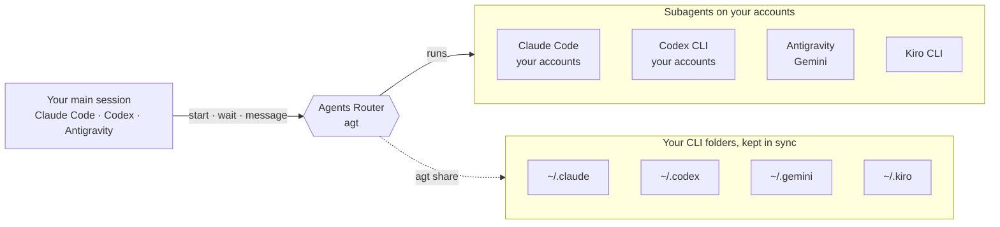
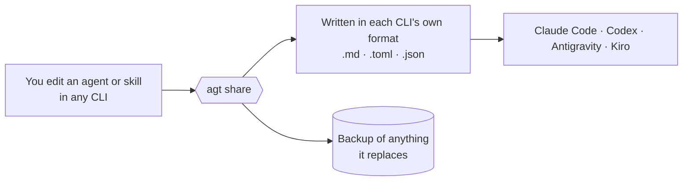
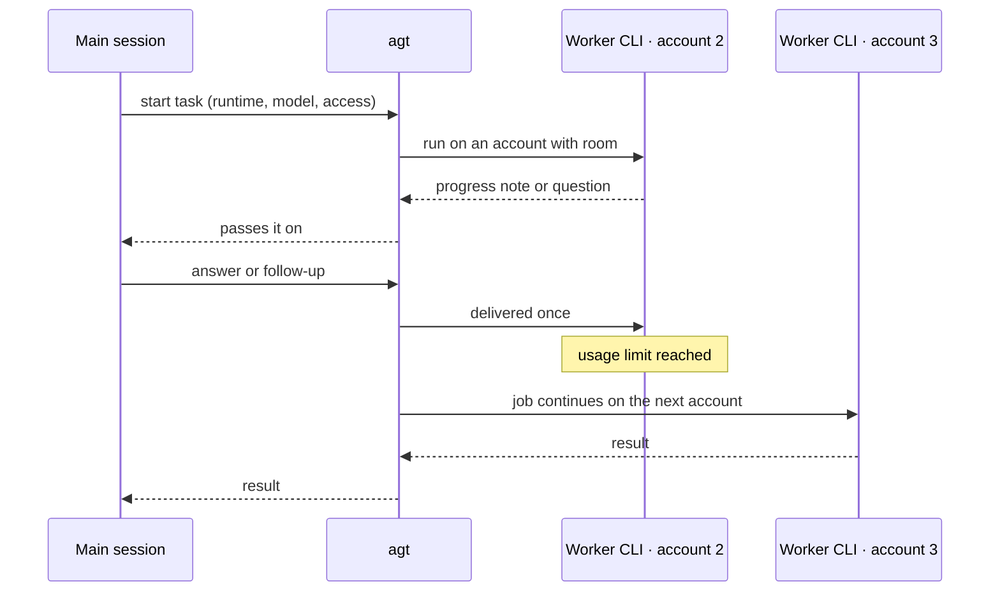

# Agents Router

Agents Router (`agt`) keeps agents, skills, MCP servers and instruction files in sync between Claude Code, Codex CLI, Kiro CLI and Antigravity, and runs subagents in those CLIs on your own accounts, switching accounts when one hits its usage limit.

[](LICENSE)




| | |
|---|---|
| **What it is** | A command (`agt`), a plugin for Claude Code, Codex and Antigravity, and an MCP server for any other client |
| **What it isn't** | An API proxy or model router: every subagent is the vendor's own CLI with your own login |
| **Needs** | Python 3.11 or newer and its one dependency, [rich](https://github.com/Textualize/rich), which draws color for a person at a terminal (git to install) |
| **Tested live** | Windows, with Claude Code 2.1.299, Codex 0.162.1 and Antigravity 1.4.0 |

## Install

Paste this into Claude Code, Codex or Antigravity:

```text
Install and set up Agents Router for me from https://github.com/Watcharagorn/agents-router.
If `agt` isn't installed, install it with
`uv tool install --managed-python git+https://github.com/Watcharagorn/agents-router` (or pipx),
asking for any sandbox permission you need. If `agt` is there but has no `agt guide` command
(older than 0.10), run `agt update` first. Then run `agt guide setup` and follow it: do the
routine steps yourself, show me the remaining choices together once, apply what I pick, and
tell me only what's left for me (logins, reloads). If you can't run commands, read
skills/agents-router-setup/SKILL.md in that repo instead.
```

Your agent installs `agt` and puts the plugin in every CLI and Claude Code profile you have (`~/.claude`, `~/.claude-work` and so on). It then asks you once about sharing and options. Browser logins and reloading your sessions are left to you; it lists them at the end.

- **Needs:** git, and [uv](https://docs.astral.sh/uv/getting-started/installation/) (`brew install uv` on a Mac) or pipx.
- **Not on PyPI:** the PyPI package named `agt` is a different project.
- **Later:** `agt update` updates `agt` and the plugin everywhere it is.

<details>
<summary>Install it yourself in a terminal</summary>

| Step | Command |
|---|---|
| 1. Install `agt` | `uv tool install --managed-python git+https://github.com/Watcharagorn/agents-router` (or `pipx install git+https://github.com/Watcharagorn/agents-router`) |
| 2. Set up every installed CLI and Claude profile | `agt setup` (Enter applies it; `--dry-run` only shows it) |
| Later: update everything | `agt update` |

- **`agt` not found:** run `uv tool update-shell` (or `pipx ensurepath`) and open a new terminal.
- **What `agt setup` does:**
  - installs the plugin in each installed CLI and in each of your logged-in Claude Code profiles (`--claude-profiles` picks which);
  - suggests what to share;
  - lists what's left for you.

  Profiles already on this machine need no `--account`.

| Plugin by hand | Command |
|---|---|
| Claude Code | `/plugin install agents-router --marketplace Watcharagorn/agents-router` in a session, or `claude plugin install agents-router --marketplace Watcharagorn/agents-router` |
| Codex | `agt setup --host codex` (the plugin and native relay agents) |
| Antigravity | `agy plugin install https://github.com/Watcharagorn/agents-router`; `agt setup --host antigravity` adds the native relay agents |
| Any MCP client | Server command `agt`, argument `mcp` |

Per host details: [docs/hosts.md](docs/hosts.md).

</details>

## Quick start

| I want to | Do this | Guide |
|---|---|---|
| Hand a task to Codex | Ask your session: "have Codex review this branch" | [Codex](docs/codex.md) |
| Give roles their providers | `agt roles config` | [Roles](docs/roles.md) |
| Run a subagent from a terminal | `agt run --runtime codex --access read "Review the diff on this branch"` | [Hosts](docs/hosts.md) |
| Delegate from Claude Code | `/agents-router:delegate <task>` | [Claude Code](docs/claude-code.md) |
| See what sharing would do | `agt share enable --dry-run` | [Sharing](docs/share.md#turning-it-on) |
| Turn sharing on | `agt share enable`, then Enter | [Sharing](docs/share.md#turning-it-on) |
| Check what's in sync | `agt share status` | [Sharing](docs/share.md#everyday-use) |
| Use your other Claude profiles | Nothing to set up: `account=claude-work` | [Claude Code](docs/claude-code.md#2-your-other-profiles-work-with-no-setup) |
| Add a Claude account | `agt accounts add max-2` | [Claude Code](docs/claude-code.md#3-add-more-accounts) |
| Add a Codex account | `agt accounts add plus-2 --runtime codex` | [Codex](docs/codex.md#extra-accounts) |
| Test every account | `agt doctor --live --runtime <runtime>` (one tiny job each; uses a little quota) | [Claude Code](docs/claude-code.md#4-check) |
| Preview delegation rules | `agt rules` | [Delegation rules](docs/delegation.md) |

## Supported CLIs

| | Claude Code | Codex CLI | Antigravity (Gemini) | Kiro CLI |
|---|:-:|:-:|:-:|:-:|
| **Main session (host)** | Plugin, relay agents in the agent list | Plugin, native relay agents | Plugin, native relay agents | — |
| **Subagent** | ✓ `claude -p` | ✓ `codex exec` | ✓ `agy` | ✓ `kiro-cli chat --no-interactive` ([checked live](docs/kiro.md#checked-live)) |
| **Progress notes and questions to the parent** | ✓ | ✓ | With an account cap of 1 (`max_jobs_per_account = 1` under `[antigravity]`) | — |
| **Follow-ups to a job** | ✓ | ✓ | ✓ | — |
| **Extra accounts** | ✓ | ✓ | At your own risk | One account |
| **Switches account at a usage limit** | ✓ | ✓ | ✓ | — (one account) |
| **Shares agents and skills** | ✓ | ✓ | ✓ | ✓ |
| **Shares instructions** | ✓ | ✓ | ✓ | ✓ (Kiro's docs say the CLI loads it; not checked live) |
| **Shares MCP servers** | ✓ | ✓ | ✓ | ✓ |
| **Shares hooks** | ✓ | ✓ | ✓ | — |
| **Shares plugins** | ✓ | ✓ | — | — |
| **Guide** | [Claude Code](docs/claude-code.md) | [Codex](docs/codex.md) | [Gemini](docs/gemini.md) | [Kiro](docs/kiro.md) |

- **Kiro's gaps, and why:**
  - **Host:** agt has no Kiro plugin.
  - **Parent channel:** agt writes nothing into `~/.kiro`, so a Kiro worker has no tools to message its main session.
  - **Follow-ups:** Kiro's plain-text output carries no session id, so a follow-up doesn't reach a running Kiro job, and a finished one can't be continued.
  - **Accounts:** Kiro keeps one login per machine.
  - **Hooks:** agt doesn't read or write Kiro's hooks yet.
  - **Plugins:** Kiro installs none.
  - **Shell in `edit` jobs:** none yet; use `full` when a Kiro job must run commands ([Kiro](docs/kiro.md)).
- **Any other MCP client:** host only, through `agt mcp` ([hosts](docs/hosts.md#any-other-mcp-client)).
- **Cursor, Gemini CLI, Copilot, OpenCode and others:** not supported as subagents yet; as hosts they work through `agt mcp` ([CLI comparison](docs/research/cli-permissions-and-headless.md)).

## Share your setup between Claude Code, Codex, Kiro and Antigravity



| Kind | Turn on with | Note |
|---|---|---|
| Agents and skills | `agt share enable` | Edits in any CLI reach the others |
| A repo's own agents and skills | `agt share repo add <path>` | Shares between that repo's CLI folders (`.claude/agents`, `.kiro/agents` …) |
| Instructions | `agt share kinds add instructions`, then `agt share adopt` | One marked block; the rest of each file stays that CLI's own |
| MCP servers | `agt share kinds add mcp` | A server with a secret written into it stays in its CLI |
| Hooks | `agt share kinds add hooks` | Each hook goes to a CLI only after you approve it there |
| Plugins | `agt share kinds add plugins` | Claude Code and Codex; one the other CLI would load only partly waits for your yes |

`agt share undo` restores what the last change to an agent or skill replaced. Full guide: [Sharing agents and skills](docs/share.md).

## Subagents in Claude Code, Codex, Antigravity and Kiro



| Where the main session runs | How it starts a subagent |
|---|---|
| Claude Code | Relay agents `agents-router:agt-claude`, `-codex`, `-antigravity`, `-kiro`, or `/agents-router:delegate <task>` |
| Codex | Native `spawn_agent` with `agt-claude`, `agt-codex` or `agt-antigravity` |
| Antigravity | Native `invoke_subagent` with `agt-claude`, `agt-codex` or `agt-antigravity` |
| Any MCP client | `subagent_start`, `subagent_wait`, `subagent_message`, `subagent_result` |
| A terminal | `agt run` (waits for the result) or `agt start` (background) |

- **Claude Code:** each relay shows in the agent list with the model and task; open it to watch the worker's steps. Hooks wake an idle session when a subagent finishes or asks something.
- **Other CLIs:** a subagent in a different CLI from its host gets a note naming your instruction files and skill folders. Codex and Gemini subagents started from Claude Code also get that session's MCP servers.
- **Kiro from Codex or Antigravity:** start Kiro jobs with the MCP tools.
- **Codex and Antigravity relays:** their app views still need checks ([hosts](docs/hosts.md#codex)).

## Multiple accounts, one setup, switching at usage limits

| | Claude Code | Codex | Antigravity |
|---|---|---|---|
| **Picks** | Lowest recent usage with a free slot | Ranked by 5-hour and weekly usage, like Claude | Least recently used, not cooling down |
| **At a usage limit** | Cools down; the job continues on the next account with its transcript | Cools down until the reported reset; the job starts again on the next account with the partial output | Cools down; the job starts again on the next account with the partial output |
| **Turn switching off** | `failover = "off"` under `[claude]` | `failover = "off"` under `[codex]` | `failover = "off"` under `[antigravity]` |

Switching applies to subagent jobs; your main session stays on its own account. A job pinned with `account` never switches. Kiro jobs run on your one Kiro login, so they never switch.

## How the shared setup works

Your normal config folder (`~/.claude`, `~/.codex`) is the one pool. Each extra account's folder holds only its login, state and session history, and is pointed at the pool before every run:

| From your config folder | Reaches each extra account as |
|---|---|
| `agents/`, `commands/` | One link to your folder |
| Skills | One link per skill |
| `CLAUDE.md`, `AGENTS.md` | Hard links: the same file on disk |
| Project memory | A link to your main project memory |
| Settings, MCP servers, plugins | Launch flags (`--settings`, `--mcp-config`, `--plugin-dir`), minus anything that would pick a different login |
| Codex `config.toml` | Written into the account folder, which keeps its own trust and notice tables |

- **Your folders are never rewritten** by this. Only `agt share`, once on, writes into them: copies of your agents and skills and, for the kinds you turn on, the instruction block, MCP server entries, approved hook entries and plugin installs, with a backup of anything it replaces.
- **Not shared:** tools built into the Claude desktop app (its browser or terminal panes) belong to the app, so CLI workers can't have them.
- **Check it:** `agt doctor --live` starts a tiny job on each account and compares what each one loaded.

## Limits

| Setting | Default | What it does |
|---|---|---|
| `max_jobs` | No cap | Subagents running at once on this machine |
| `max_jobs_per_account` | No cap | Workers at once per account; extra jobs wait |
| `usage_ceiling` | `0.95` | No new jobs on an account at or above 95% of a usage window it reports |
| `failover` | `"on-limit"` | Continue on the next account at a usage limit |
| `plan` | Not set | Plan preset caps; `"auto"` reads a Claude account's plan from its login |
| `max_depth` | `1` | Workers can't start subagents of their own |

- **Change a setting:** `agt config set <key> <value>`; per-CLI keys take the CLI first, e.g. `agt config set claude.max_jobs_per_account 1` ([configuration](docs/configuration.md#agt-config)).
- **More jobs at once:** `override=<the user's own words>` (relay or MCP) or `--override "..."` (`agt run`, `agt start`) lifts agt's caps and queueing for one start. Cooldowns after real usage limits, model and effort limits, login, depth and access still apply ([details](docs/configuration.md#a-user-authorized-override)).

## Safety

| Access | Claude Code | Codex | Antigravity | Kiro |
|---|---|---|---|---|
| `read` | Read-only tools and shell commands; a hook blocks writes and secret paths | Read-only sandbox | Plan mode behind the review gate | Read and search files; search and fetch from the web |
| `edit` | Claude Code's auto mode | Workspace-write sandbox with Codex's auto-review | Edits in the project, commands in agy's sandbox, behind the review gate | Read and write files; no shell (use `full` for commands) |
| `full` | Skips permission checks | Bypasses approvals and sandbox | No gate, no sandbox | Trusts all tools |

- **`full`:** an explicit choice per job, only when you ask for it.
- **Logins:** every model call comes from the vendor's own CLI. agt never reads, copies or forwards your CLI logins.
- **Gemini review gate:** fixed rules plus a separate reviewer model ([how it works](docs/gemini.md#safety)).

## FAQ

<details>
<summary><b>How do I share skills and agents between Claude Code and Codex?</b></summary>

`agt share enable` (`--dry-run` first to see the plan). Agents and skills are then copied between Claude Code, Codex, Kiro and Antigravity in each CLI's own format, and an edit in any of them reaches the others. See [Sharing agents and skills](docs/share.md).

</details>

<details>
<summary><b>Can Claude Code run Codex as a subagent?</b></summary>

Yes. Ask your session ("have Codex review this branch") or run `agt run --runtime codex --access read "<task>"`. The worker is the official `codex exec` with your login; its result comes back to your session. Gemini (through Antigravity CLI, `agy`) works the same way; Kiro CLI works too; it has had a first live run (see [Kiro](docs/kiro.md#checked-live)). See [Codex](docs/codex.md).

</details>

<details>
<summary><b>How do I keep CLAUDE.md and AGENTS.md in sync?</b></summary>

`agt share kinds add instructions`, then `agt share adopt` adds agt's marked block to your user-level `CLAUDE.md`, Codex's `AGENTS.md`, Antigravity's `GEMINI.md` and Kiro's steering file (`--wrap` puts a file's own text inside it). The block stays the same everywhere; the rest of each file stays that CLI's own. See [Sharing instructions](docs/share.md#sharing-instructions).

</details>

<details>
<summary><b>How do I share MCP servers between Claude Code, Codex and Kiro?</b></summary>

`agt share kinds add mcp`. A user MCP server you add in one CLI then reaches the others' settings, with a few exceptions per CLI (Antigravity, for one, doesn't take a server that needs a `${VAR}` value). A server with a secret written into it stays put; with a `${VAR}` reference instead, it can share. See [Sharing MCP servers](docs/share.md#sharing-mcp-servers).

</details>

<details>
<summary><b>How do I use multiple Claude Code accounts?</b></summary>

Each extra account is its own config folder with its own login: `agt accounts add max-2` adds one and opens its login. Your MCP servers, skills, plugins and `CLAUDE.md` reach it through links and launch flags, not copies ([how](#how-the-shared-setup-works)). `agt launch` opens an interactive session on the account with the most room left. See [Claude Code](docs/claude-code.md).

</details>

<details>
<summary><b>Does it switch accounts when one hits its usage limit?</b></summary>

For subagent jobs, yes: a Claude, Codex or Gemini job continues on the next account, and a Claude conversation moves with its transcript. Your main session stays on its own account, and `failover = "off"` turns switching off. Extra Antigravity accounts are at your own risk; Kiro uses one account. See [Provider terms and your accounts](#provider-terms-and-your-accounts).

</details>

<details>
<summary><b>How is it different from account switchers and config-sync tools?</b></summary>

| Tool type | Examples | Scope |
|---|---|---|
| Account switchers | claude-swap, ccs, caam | Accounts within one CLI |
| Config-sync tools | rulesync, ruler | One canonical config written into each CLI's files |
| Cross-CLI plugin | OpenAI's codex-plugin-cc | Runs Codex from Claude Code |
| Agents Router | | Your own files kept in sync in both directions across CLIs, subagents across them, and a pool of your accounts |

See [prior art](docs/research/prior-art.md) and [how other projects share setups](docs/research/lifecycle-and-sharing.md).

</details>

## Documentation

| Document | Contents |
|---|---|
| [Setup guide for agents](src/agents_router/guides/setup.md) | What `agt guide setup` prints: install, set up, repair and uninstall |
| [Hosts](docs/hosts.md) | Install and use from Claude Code, Codex, Antigravity and other MCP clients |
| [Claude Code](docs/claude-code.md) | Accounts, what is shared, switching, troubleshooting |
| [Codex](docs/codex.md), [Gemini](docs/gemini.md) and [Kiro](docs/kiro.md) | The other subagent CLIs |
| [Sharing agents and skills](docs/share.md) | `agt share`: agents, skills, instructions, MCP servers, hooks and plugins across Claude Code, Codex, Antigravity and Kiro |
| [Configuration](docs/configuration.md) | Settings files per workspace, `agt config`, limits, the log, files, environment |
| [Roles](docs/roles.md) | Reviewer, Builder and your own roles: which providers each uses, `agt roles config`, role agents |
| [Delegation rules](docs/delegation.md) | Optional model tiers, work folders and helper limits |
| [Design](docs/design.md) | Architecture, decisions and what was verified |
| [Research](docs/README.md#design-and-research) | CLI comparison, prior art, multi-account tools, provider terms |

All guides: [docs index](docs/README.md).

## For AI agents

Run `agt guide setup` and follow it. It prints the steps that match the installed version:
- install or upgrade;
- one combined question for the person;
- the plugin in every CLI and Claude Code profile;
- reaching a named profile with `account=`;
- the hand-off list;
- checking, repairing and uninstalling.

If `agt` isn't installed yet:

```bash
uv tool install --managed-python git+https://github.com/Watcharagorn/agents-router
agt guide setup
```

Without a shell, read [skills/agents-router-setup/SKILL.md](skills/agents-router-setup/SKILL.md), which carries the same guide. More for agents working in this repository: [AGENTS.md](AGENTS.md).

## Provider terms and your accounts

| Vendor | What it publishes | What agt does |
|---|---|---|
| Anthropic | Documents running several accounts side by side with separate config folders | Uses your extra Claude accounts that way |
| OpenAI | Ships its own plugin that runs Codex from Claude Code | Runs `codex exec` with your login |
| Google | The Antigravity FAQ rules out wrapping `agy` on consumer plans and automating account rotation | Uses your one signed-in account; accounts you add are at your own risk, and `failover = "off"` turns switching off |

Details and quotes: [provider terms](docs/research/provider-terms.md). Each vendor's terms apply to your accounts.

## Repository layout

<details>
<summary>Folders and what they hold</summary>

```text
src/agents_router/      Core: jobs, account pool, shared setup, messages, settings, MCP server, agt CLI
  runtimes/             Claude Code, Codex, Antigravity and Kiro adapters
  share/                agt share: agents, skills, instructions, MCP servers, hooks and plugins across the CLIs
  agy_review/           The review gate for Antigravity workers
  guides/               What `agt guide` prints (setup.md: install, set up, repair, uninstall)
.claude-plugin/         Claude Code and Codex plugin manifest and marketplace
agents/                 Relay agents that show jobs in Claude Code's agent list
src/agents_router/templates/codex-agents/   Native Codex relay definitions installed by setup/update
plugin.json, mcp_config.json   Antigravity plugin
skills/agents-router/   The skill that teaches the host agent how to use subagents
skills/agents-router-setup/   The setup guide as a skill, for agents installing or repairing agt
commands/               /agents-router:delegate
tests/                  Unit and end-to-end tests with fake CLIs
scripts/                The live-check sandbox and the guide's copy into the setup skill
.claude/skills/agt-maintainer/   How to work on this repository (Codex reads it through .codex/skills)
adapters/antigravity/   The original standalone AGY server (superseded)
docs/                   Guides, design and research
```

</details>

## Contributing

Issues and pull requests are welcome. Run the tests before sending a change (with `PYTHONPATH=src`, or after `pip install -e .`):

```bash
python -m unittest discover -s tests -t tests
```

New runtime adapters keep the vendor's binary unmodified, leave authentication to it, and default to its safer permission mode.

## License and credit

By [Watcharagorn](https://github.com/Watcharagorn), based on [CLI Subagents](https://github.com/lunati228/CLI-Subagents) by [lunati](https://github.com/lunati228). Licensed under [Apache-2.0](LICENSE); keep the [NOTICE](NOTICE) file when you redistribute or build on it. To cite it: [CITATION.cff](CITATION.cff).
