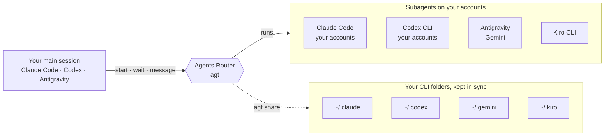
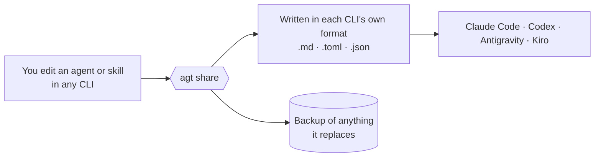
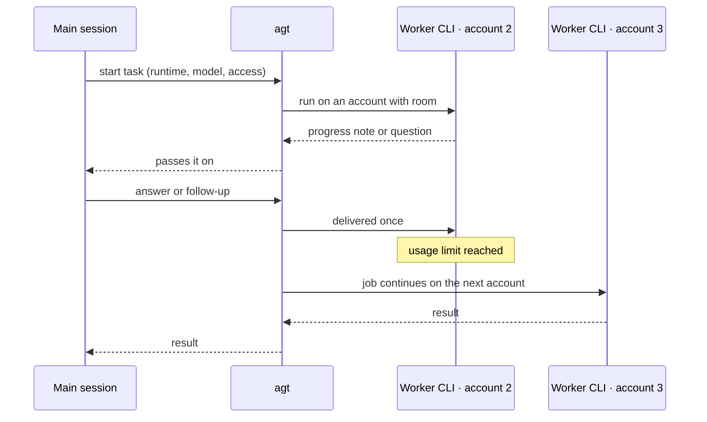

# Agents Router

Agents Router (`agt`) keeps agents, skills, MCP servers and instruction files in sync between Claude Code, Codex CLI, Kiro CLI and Antigravity, and runs subagents in those CLIs on your own accounts, switching accounts when one hits its usage limit.

[](LICENSE)




| | |
|---|---|
| **What it is** | A command (`agt`), a plugin for Claude Code, Codex and Antigravity, and an MCP server for any other client |
| **What it isn't** | An API proxy or model router: every subagent is the vendor's own CLI with your own login |
| **Needs** | Python 3.11 or newer and its one dependency, [rich](https://github.com/Textualize/rich), which draws color for a person at a terminal (git to install) |
| **Tested live** | Windows, with Claude Code 2.1.299, Codex 0.162.1 and Antigravity 1.4.0 |

## Install

| Step | Command |
|---|---|
| 1. Install `agt` | `uv tool install --managed-python git+https://github.com/Watcharagorn/agents-router` |
| 2. Set up every installed CLI | `agt setup` |
| Later: update everything | `agt update` |

- **No uv yet:** [install it](https://docs.astral.sh/uv/getting-started/installation/) (`brew install uv` on a Mac), or use pipx: `pipx install git+https://github.com/Watcharagorn/agents-router`. Both need git.
- **Not on PyPI:** the PyPI package named `agt` is a different project.
- **`agt` not found:** run `uv tool update-shell` (or `pipx ensurepath`) and open a new terminal.
- **What `agt setup` does:** installs the plugin in each installed CLI, registers the logged-in account folders you name with `--account`, suggests what to share, and lists what's left for you. Enter applies it; `--dry-run` only shows it.

<details>
<summary>Install the plugin by hand</summary>

| Host | Command |
|---|---|
| Claude Code | `/plugin install agents-router --marketplace Watcharagorn/agents-router` in a session, or `claude plugin install agents-router --marketplace Watcharagorn/agents-router` |
| Codex | `agt setup --host codex` (the plugin and native relay agents) |
| Antigravity | `agy plugin install https://github.com/Watcharagorn/agents-router`; `agt setup --host antigravity` adds the native relay agents |
| Any MCP client | Server command `agt`, argument `mcp` |

Per host details: [docs/hosts.md](docs/hosts.md).

</details>

## Quick start

| I want to | Do this | Guide |
|---|---|---|
| Hand a task to Codex | Ask your session: "have Codex review this branch" | [Codex](docs/codex.md) |
| Run a subagent from a terminal | `agt run --runtime codex --access read "Review the diff on this branch"` | [Hosts](docs/hosts.md) |
| Delegate from Claude Code | `/agents-router:delegate <task>` | [Claude Code](docs/claude-code.md) |
| See what sharing would do | `agt share enable --dry-run` | [Sharing](docs/share.md#turning-it-on) |
| Turn sharing on | `agt share enable`, then Enter | [Sharing](docs/share.md#turning-it-on) |
| Check what's in sync | `agt share status` | [Sharing](docs/share.md#everyday-use) |
| Add a Claude account | `agt accounts add max-2` | [Claude Code](docs/claude-code.md#2-add-your-other-accounts) |
| Add a Codex account | `agt accounts add plus-2 --runtime codex` | [Codex](docs/codex.md#extra-accounts) |
| Test every account | `agt doctor --live --runtime <runtime>` (one tiny job each; uses a little quota) | [Claude Code](docs/claude-code.md#3-check) |
| Preview delegation rules | `agt rules` | [Delegation rules](docs/delegation.md) |

## Supported CLIs

| | Claude Code | Codex CLI | Antigravity (Gemini) | Kiro CLI |
|---|:-:|:-:|:-:|:-:|
| **Main session (host)** | Plugin, relay agents in the agent list | Plugin, native relay agents | Plugin, native relay agents | — |
| **Subagent** | ✓ `claude -p` | ✓ `codex exec` | ✓ `agy` | New, not run live yet |
| **Progress notes and questions to the parent** | ✓ | ✓ | With an account cap of 1 (`max_jobs_per_account = 1` under `[antigravity]`) | — |
| **Extra accounts** | ✓ | ✓ | At your own risk | One account |
| **Switches account at a usage limit** | ✓ | ✓ | ✓ | — |
| **Shares agents and skills** | ✓ | ✓ | ✓ | ✓ |
| **Shares instructions** | ✓ | ✓ | ✓ | ✓ (not yet checked with the CLI) |
| **Shares MCP servers** | ✓ | ✓ | ✓ | ✓ |
| **Shares hooks** | ✓ | ✓ | ✓ | — |
| **Shares plugins** | ✓ | ✓ | — | — |
| **Guide** | [Claude Code](docs/claude-code.md) | [Codex](docs/codex.md) | [Gemini](docs/gemini.md) | [Kiro](docs/kiro.md) |

- **Any other MCP client:** host only, through `agt mcp` ([hosts](docs/hosts.md#any-other-mcp-client)).
- **Cursor, Gemini CLI, Copilot, OpenCode and others:** not supported as subagents yet; as hosts they work through `agt mcp` ([CLI comparison](docs/research/cli-permissions-and-headless.md)).

## Share your setup between Claude Code, Codex, Kiro and Antigravity



| Kind | Turn on with | Note |
|---|---|---|
| Agents and skills | `agt share enable` | Edits in any CLI reach the others |
| A repo's own agents and skills | `agt share repo add <path>` | Shares between that repo's CLI folders (`.claude/agents`, `.kiro/agents` …) |
| Instructions | `agt share kinds add instructions`, then `agt share adopt` | One marked block; the rest of each file stays that CLI's own |
| MCP servers | `agt share kinds add mcp` | A server with a secret written into it stays in its CLI |
| Hooks | `agt share kinds add hooks` | Each hook goes to a CLI only after you approve it there |
| Plugins | `agt share kinds add plugins` | Claude Code and Codex; one the other CLI would load only partly waits for your yes |

`agt share undo` restores what the last change to an agent or skill replaced. Full guide: [Sharing agents and skills](docs/share.md).

## Subagents in Claude Code, Codex, Antigravity and Kiro



| Where the main session runs | How it starts a subagent |
|---|---|
| Claude Code | Relay agents `agents-router:agt-claude`, `-codex`, `-antigravity`, `-kiro`, or `/agents-router:delegate <task>` |
| Codex | Native `spawn_agent` with `agt-claude`, `agt-codex` or `agt-antigravity` |
| Antigravity | Native `invoke_subagent` with `agt-claude`, `agt-codex` or `agt-antigravity` |
| Any MCP client | `subagent_start`, `subagent_wait`, `subagent_message`, `subagent_result` |
| A terminal | `agt run` (waits for the result) or `agt start` (background) |

- **Claude Code:** each relay shows in the agent list with the model and task; open it to watch the worker's steps. Hooks wake an idle session when a subagent finishes or asks something.
- **Other CLIs:** a subagent in a different CLI from its host gets a note naming your instruction files and skill folders. Codex and Gemini subagents started from Claude Code also get that session's MCP servers.
- **Kiro from Codex or Antigravity:** start Kiro jobs with the MCP tools.
- **Codex and Antigravity relays:** their app views still need checks ([hosts](docs/hosts.md#codex)).

## Multiple accounts, one setup, switching at usage limits

| | Claude Code | Codex | Antigravity |
|---|---|---|---|
| **Picks** | Lowest recent usage with a free slot | Ranked by 5-hour and weekly usage, like Claude | Least recently used, not cooling down |
| **At a usage limit** | Cools down; the job continues on the next account with its transcript | Cools down until the reported reset; the job starts again on the next account with the partial output | Cools down; the job starts again on the next account with the partial output |
| **Turn switching off** | `failover = "off"` under `[claude]` | `failover = "off"` under `[codex]` | `failover = "off"` under `[antigravity]` |

Switching applies to subagent jobs; your main session stays on its own account. A job pinned with `account` never switches.

## How the shared setup works

Your normal config folder (`~/.claude`, `~/.codex`) is the one pool. Each extra account's folder holds only its login, state and session history, and is pointed at the pool before every run:

| From your config folder | Reaches each extra account as |
|---|---|
| `agents/`, `commands/` | One link to your folder |
| Skills | One link per skill |
| `CLAUDE.md`, `AGENTS.md` | Hard links: the same file on disk |
| Project memory | A link to your main project memory |
| Settings, MCP servers, plugins | Launch flags (`--settings`, `--mcp-config`, `--plugin-dir`), minus anything that would pick a different login |
| Codex `config.toml` | Written into the account folder, which keeps its own trust and notice tables |

- **Your folders are never rewritten** by this. Only `agt share`, once on, writes into them: copies of your agents and skills and, for the kinds you turn on, the instruction block, MCP server entries, approved hook entries and plugin installs, with a backup of anything it replaces.
- **Not shared:** tools built into the Claude desktop app (its browser or terminal panes) belong to the app, so CLI workers can't have them.
- **Check it:** `agt doctor --live` starts a tiny job on each account and compares what each one loaded.

## Limits

| Setting | Default | What it does |
|---|---|---|
| `max_jobs` | No cap | Subagents running at once on this machine |
| `max_jobs_per_account` | No cap | Workers at once per account; extra jobs wait |
| `usage_ceiling` | `0.95` | No new jobs on an account at or above 95% of a usage window it reports |
| `failover` | `"on-limit"` | Continue on the next account at a usage limit |
| `plan` | Not set | Plan preset caps; `"auto"` reads a Claude account's plan from its login |
| `max_depth` | `1` | Workers can't start subagents of their own |

- **Change a setting:** `agt config set <key> <value>`; per-CLI keys take the CLI first, e.g. `agt config set claude.max_jobs_per_account 1` ([configuration](docs/configuration.md#agt-config)).
- **More jobs at once:** `override=<the user's own words>` (relay or MCP) or `--override "..."` (`agt run`, `agt start`) lifts agt's caps and queueing for one start. Cooldowns after real usage limits, model and effort limits, login, depth and access still apply ([details](docs/configuration.md#a-user-authorized-override)).

## Safety

| Access | Claude Code | Codex | Antigravity | Kiro |
|---|---|---|---|---|
| `read` | Read-only tools and shell commands; a hook blocks writes and secret paths | Read-only sandbox | Plan mode behind the review gate | Read and search files |
| `edit` | Claude Code's auto mode | Workspace-write sandbox with Codex's auto-review | Edits in the project, commands in agy's sandbox, behind the review gate | Read and write files; no shell (use `full` for commands) |
| `full` | Skips permission checks | Bypasses approvals and sandbox | No gate, no sandbox | Trusts all tools |

- **`full`:** an explicit choice per job, only when you ask for it.
- **Logins:** every model call comes from the vendor's own CLI. agt never reads, copies or forwards your CLI logins.
- **Gemini review gate:** fixed rules plus a separate reviewer model ([how it works](docs/gemini.md#safety)).

## FAQ

<details>
<summary><b>How do I share skills and agents between Claude Code and Codex?</b></summary>

`agt share enable` (`--dry-run` first to see the plan). Agents and skills are then copied between Claude Code, Codex, Kiro and Antigravity in each CLI's own format, and an edit in any of them reaches the others. See [Sharing agents and skills](docs/share.md).

</details>

<details>
<summary><b>Can Claude Code run Codex as a subagent?</b></summary>

Yes. Ask your session ("have Codex review this branch") or run `agt run --runtime codex --access read "<task>"`. The worker is the official `codex exec` with your login; its result comes back to your session. Gemini (through Antigravity CLI, `agy`) works the same way; Kiro CLI support hasn't been run live yet. See [Codex](docs/codex.md).

</details>

<details>
<summary><b>How do I keep CLAUDE.md and AGENTS.md in sync?</b></summary>

`agt share kinds add instructions`, then `agt share adopt` adds agt's marked block to your user-level `CLAUDE.md`, Codex's `AGENTS.md`, Antigravity's `GEMINI.md` and Kiro's steering file (`--wrap` puts a file's own text inside it). The block stays the same everywhere; the rest of each file stays that CLI's own. See [Sharing instructions](docs/share.md#sharing-instructions).

</details>

<details>
<summary><b>How do I share MCP servers between Claude Code, Codex and Kiro?</b></summary>

`agt share kinds add mcp`. A user MCP server you add in one CLI then reaches the others' settings, with a few exceptions per CLI (Antigravity, for one, doesn't take a server that needs a `${VAR}` value). A server with a secret written into it stays put; with a `${VAR}` reference instead, it can share. See [Sharing MCP servers](docs/share.md#sharing-mcp-servers).

</details>

<details>
<summary><b>How do I use multiple Claude Code accounts?</b></summary>

Each extra account is its own config folder with its own login: `agt accounts add max-2` adds one and opens its login. Your MCP servers, skills, plugins and `CLAUDE.md` reach it through links and launch flags, not copies ([how](#how-the-shared-setup-works)). `agt launch` opens an interactive session on the account with the most room left. See [Claude Code](docs/claude-code.md).

</details>

<details>
<summary><b>Does it switch accounts when one hits its usage limit?</b></summary>

For subagent jobs, yes: a Claude, Codex or Gemini job continues on the next account, and a Claude conversation moves with its transcript. Your main session stays on its own account, and `failover = "off"` turns switching off. Extra Antigravity accounts are at your own risk; Kiro uses one account. See [Provider terms and your accounts](#provider-terms-and-your-accounts).

</details>

<details>
<summary><b>How is it different from account switchers and config-sync tools?</b></summary>

| Tool type | Examples | Scope |
|---|---|---|
| Account switchers | claude-swap, ccs, caam | Accounts within one CLI |
| Config-sync tools | rulesync, ruler | One canonical config written into each CLI's files |
| Cross-CLI plugin | OpenAI's codex-plugin-cc | Runs Codex from Claude Code |
| Agents Router | | Your own files kept in sync in both directions across CLIs, subagents across them, and a pool of your accounts |

See [prior art](docs/research/prior-art.md) and [how other projects share setups](docs/research/lifecycle-and-sharing.md).

</details>

## Documentation

| Document | Contents |
|---|---|
| [Hosts](docs/hosts.md) | Install and use from Claude Code, Codex, Antigravity and other MCP clients |
| [Claude Code](docs/claude-code.md) | Accounts, what is shared, switching, troubleshooting |
| [Codex](docs/codex.md), [Gemini](docs/gemini.md) and [Kiro](docs/kiro.md) | The other subagent CLIs |
| [Sharing agents and skills](docs/share.md) | `agt share`: agents, skills, instructions, MCP servers, hooks and plugins across Claude Code, Codex, Antigravity and Kiro |
| [Configuration](docs/configuration.md) | Settings files per workspace, `agt config`, limits, the log, files, environment |
| [Delegation rules](docs/delegation.md) | Optional model tiers, work folders and helper limits |
| [Design](docs/design.md) | Architecture, decisions and what was verified |
| [Research](docs/README.md#design-and-research) | CLI comparison, prior art, multi-account tools, provider terms |

All guides: [docs index](docs/README.md).

## For AI agents

To have your agent (Claude Code, Codex, Antigravity or another) install this for you, paste a prompt like this:

```text
Set up Agents Router from https://github.com/Watcharagorn/agents-router by following
the "For AI agents" section of its README. Then ask me what else I want, such as my
other account folders, sharing my agents and skills between my CLIs, or delegation
rules, and tell me exactly what I still have to do myself.
```

<details>
<summary><b>Steps for the agent</b> (no slash commands needed)</summary>

1. **Install `agt`** and check it with `agt --version`:

   ```bash
   uv tool install --managed-python git+https://github.com/Watcharagorn/agents-router
   ```

   Without uv: `pipx install git+https://github.com/Watcharagorn/agents-router`. Both need git. If `agt` isn't on PATH afterwards, run `uv tool update-shell` (or `pipx ensurepath`); the user then opens a new terminal.

2. **Dry run.** Ask the user whether they have other account folders (a second Claude login in `~/.claude-2`, say) and add one `--account` per folder they name. Folders that are already logged in need no new login.

   ```bash
   agt setup --dry-run --json --account max-2=~/.claude-2 --account codex:plus-2=~/.codex-2
   ```

   | Key in the proposal | Holds |
   |---|---|
   | `plugin` | The hosts it installs into |
   | `share` | The user's agents and skills, and which CLI each goes to |
   | `repos` | Repos with their own agents or skills |
   | `switches` | Worktrees, auto copy, tool widening, MCP servers, plugins, delegation rules, Codex's session line |
   | `needs_answer` | Items whose copies differ |
   | `still_needed`, `command` | What's left for the user, and the command to apply it |

3. **Ask once.** Show the share table and the switches: as suggested, change some, or the plugin only. Run the dry run again with the answers as flags, then run the newest proposal's `command` exactly as given. It includes `--yes --if-plan <id>`, which refuses if anything changed meanwhile.

   | The user wants | Flag |
   |---|---|
   | One version of an item whose copies differ | `--resolve <item>=<label>` |
   | An item kept out of one CLI | `--skip <item>@<label>` |
   | An item only in some CLIs | `--only <item>=<label>[,<label>]` |
   | Only some repos, or none | `--projects <paths>` or `--projects none` |
   | MCP servers shared | `--mcp on` |
   | Plugins shared | `--plugins on` |
   | New items wait for a pick | `--auto-copy off` |
   | Worktrees join only by command | `--worktrees command` |
   | No Codex agents that would get every tool | `--tool-widening skip` |
   | Delegation rules installed | `--rules on` |
   | Codex's session line | `--codex-session-line on` |
   | The plugin only | `--share off` |

   `agt setup` installs the plugin into each installed host with the host's own terminal commands, registers and syncs the account folders, turns sharing on, and ends with what the user still has to do. Running it twice is safe. It never starts a login and never reads credential files. `--host claude`, `--host codex` or `--host antigravity` limits it. See [For agents](docs/share.md#for-agents) in the share guide.

4. **Offer the [delegation rules](docs/delegation.md).** They set models per tier, keep work projects with the home vendor, and set helper limits; personal projects can try another CLI first and fall back to the home model. Ask whether the user wants them and which home and try-first models per tier, then preview and install with their choices. Ask for work folders if they want `--work-folder`. Nothing installs these rules without `--install`.

   ```bash
   agt rules --show --target claude --home-high "Opus 5.5" --try-low "Gemini 3.8 Flash high" --try-medium "Sol 6.1 high"
   agt rules --install --target claude --home-high "Opus 5.5" --try-low "Gemini 3.8 Flash high" --try-medium "Sol 6.1 high"
   ```

5. **Show the "Still needed from you" list.** Typical items: browser logins for accounts that aren't logged in (`agt accounts login <name>`), restarting the CLI (or `/reload-plugins` in Claude Code), and putting `agt` on PATH.

6. **Check** with `agt doctor` (no model calls). It checks every runtime that's installed; `--runtime <runtime>` checks one (`claude`, `codex`, `antigravity`, `kiro`). `--live` runs one tiny job per account in one runtime, Claude unless you name another, and uses a little quota.

**If `agt setup` fails for a host**, run its commands yourself:

| Host | Install | Update |
|---|---|---|
| Claude Code | `claude plugin marketplace add Watcharagorn/agents-router`, then `claude plugin install agents-router@agents-router` | `claude plugin marketplace update agents-router`, then `claude plugin update agents-router@agents-router` |
| Codex | `codex plugin marketplace add Watcharagorn/agents-router`, then `codex plugin add agents-router@agents-router` | `codex plugin marketplace upgrade agents-router`, then `codex plugin add agents-router@agents-router` |
| Antigravity | `agy plugin install https://github.com/Watcharagorn/agents-router` | The same command again |

These install the plugin only; `agt setup --host codex` or `--host antigravity` adds the native relay agents.

**Without a `claude` command** (common with the Claude desktop app), or when the plugin commands fail, `agt setup` declares the plugin in Claude Code's `settings.json` (`~/.claude/settings.json`, or the one in `$CLAUDE_CONFIG_DIR`), keeping every other key and saving a backup. Claude Code installs it on its next start, so the user restarts it. `agt setup --claude-route settings` takes this route directly. By hand, merge:

```json
{
  "extraKnownMarketplaces": {
    "agents-router": { "source": { "source": "github", "repo": "Watcharagorn/agents-router" } }
  },
  "enabledPlugins": { "agents-router@agents-router": true }
}
```

**Updating:** `agt update` (`--dry-run` first) reinstalls `agt` with the tool and source that installed it, updates the plugin in every host that has it, and lists the restarts. On Windows it prints the package command for you to run, because `agt` can't replace itself while running. The package by hand: `uv tool install --force git+https://github.com/Watcharagorn/agents-router` (or `pipx install --force` with the same URL).

**Registering an account folder by hand:** `agt accounts add <name> --home <folder> --no-login` (Claude by default; add `--runtime codex` or `--runtime antigravity`). Leave out `--no-login` for a new account; the user completes the login in the browser.

| Never | Instead |
|---|---|
| Read or copy credential files | Leave logins to the vendor's CLI |
| Edit files inside `~/.agents-router/homes/` | `agt` manages those folders |
| Edit a limit or safety key by hand | `agt config set`; raising a limit or loosening safety takes `--user-said "<the user's words>"` ([configuration](docs/configuration.md#agt-config)) |
| Set `override` on your own judgment | Use it only when the user asked for more jobs in this conversation, or confirmed after you warned them and told them how much of the 5-hour window is left |

More for agents working in this repository: [AGENTS.md](AGENTS.md).

</details>

## Provider terms and your accounts

| Vendor | What it publishes | What agt does |
|---|---|---|
| Anthropic | Documents running several accounts side by side with separate config folders | Uses your extra Claude accounts that way |
| OpenAI | Ships its own plugin that runs Codex from Claude Code | Runs `codex exec` with your login |
| Google | The Antigravity FAQ rules out wrapping `agy` on consumer plans and automating account rotation | Uses your one signed-in account; accounts you add are at your own risk, and `failover = "off"` turns switching off |

Details and quotes: [provider terms](docs/research/provider-terms.md). Each vendor's terms apply to your accounts.

## Repository layout

<details>
<summary>Folders and what they hold</summary>

```text
src/agents_router/      Core: jobs, account pool, shared setup, messages, settings, MCP server, agt CLI
  runtimes/             Claude Code, Codex, Antigravity and Kiro adapters
  share/                agt share: agents, skills, instructions, MCP servers, hooks and plugins across the CLIs
  agy_review/           The review gate for Antigravity workers
.claude-plugin/         Claude Code and Codex plugin manifest and marketplace
agents/                 Relay agents that show jobs in Claude Code's agent list
src/agents_router/templates/codex-agents/   Native Codex relay definitions installed by setup/update
plugin.json, mcp_config.json   Antigravity plugin
skills/agents-router/   The skill that teaches the host agent how to use subagents
commands/               /agents-router:delegate
tests/                  Unit and end-to-end tests with fake CLIs
adapters/antigravity/   The original standalone AGY server (superseded)
docs/                   Guides, design and research
```

</details>

## Contributing

Issues and pull requests are welcome. Run the tests before sending a change (with `PYTHONPATH=src`, or after `pip install -e .`):

```bash
python -m unittest discover -s tests -t tests
```

New runtime adapters keep the vendor's binary unmodified, leave authentication to it, and default to its safer permission mode.

## License and credit

By [Watcharagorn](https://github.com/Watcharagorn), based on [CLI Subagents](https://github.com/lunati228/CLI-Subagents) by [lunati](https://github.com/lunati228). Licensed under [Apache-2.0](LICENSE); keep the [NOTICE](NOTICE) file when you redistribute or build on it. To cite it: [CITATION.cff](CITATION.cff).
