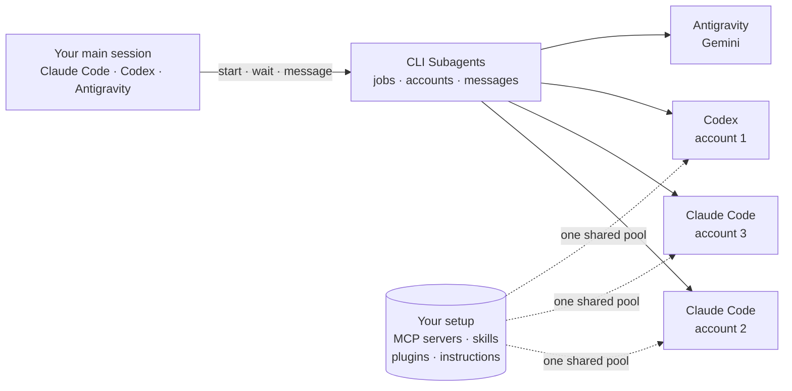

# CLI Subagents

Give your coding agent subagents that run in your other agent CLIs and on your other accounts, all with the same tools.

[](LICENSE)


Your main session, in Claude Code, Codex or Antigravity, can start subagents. Each subagent is a real Claude Code, Codex or Antigravity session running in the background on one of your accounts. Every account uses the same MCP servers, skills, plugins and instructions you already set up, so nothing has to be configured twice. When an account runs out of quota, the work moves to the next one and carries on.

It installs as a plugin in Claude Code, Codex and Antigravity, and works as a plain MCP server in any other MCP client.



## What you get

- Subagents that feel built in. Start one, keep working, and get the result back when it's done. In Claude Code the plugin wakes an idle session when a subagent finishes or asks a question, and lists any uncollected results after you resume.
- Two-way messages. A subagent can send progress notes or ask a question and wait for the answer; you can send it follow-ups while it works, and each message is delivered once.
- One setup for every account. Your MCP servers, skills, plugins, agents, `CLAUDE.md`, project memory and settings are shared from your normal config folder through links and launch flags, not copied. Only the login differs per account.
- Automatic account switching. Claude Code reports each account's 5-hour and weekly usage, and new work goes to the account with the most room. If a Claude or Codex account hits its limit mid-task, the job continues on the next account (a Claude conversation moves with its transcript). Failover is on by default and can be turned off.
- Mixing CLIs. A Claude Code session can hand a task to Codex or Gemini (through Antigravity), and the subagent is told where your instructions and skills live.
- The vendors' own safety checks. `read` jobs get read-only tools only, and `edit` jobs run in each CLI's own auto-review mode. Skipping permissions is an explicit choice per job.
- No tokens touched. Every model call comes from the vendor's own CLI with your own login. Nothing reads, copies or forwards credentials.
- Nothing to install besides Python 3.11. Pure standard library, with its own small MCP server.

## Install

1. Install the `csa` command:

   ```bash
   pipx install git+https://github.com/lunati228/CLI-Subagents
   ```

2. Add the plugin to the CLI you work in:

   | Host | Command |
   |---|---|
   | Claude Code | `/plugin install cli-subagents --marketplace lunati228/CLI-Subagents` |
   | Codex | `codex plugin marketplace add lunati228/CLI-Subagents` then `codex plugin add cli-subagents@cli-subagents` |
   | Antigravity | `agy plugin install https://github.com/lunati228/CLI-Subagents` |
   | Any MCP client | Server command `csa` with argument `mcp` |

3. Optional: add your other accounts, each with the CLI's own login.

   ```bash
   csa accounts add max-2
   csa accounts add plus-2 --runtime codex
   csa doctor --live
   ```

That's it. Ask your main session to use a subagent, or use `/cli-subagents:delegate <task>` in Claude Code. Details per host are in [docs/hosts.md](docs/hosts.md).

## Status

| Subagent CLI | State | Guide |
|---|---|---|
| Claude Code (`claude -p`) | Works | [Claude Code](docs/claude-code.md) |
| Codex (`codex exec`) | Works | [Codex](docs/codex.md) |
| Antigravity (`agy`, Gemini) | Works, single account | [Gemini](docs/gemini.md) |
| Cursor, Gemini CLI, Copilot, OpenCode, others | Researched | [CLI comparison](docs/research/cli-permissions-and-headless.md) |

Tested live on Windows with Claude Code 2.1.295, Codex 0.162.1 and Antigravity 1.3.5; the test suite also runs on macOS and Linux in CI.

## How the shared setup works

Your normal config folder (`~/.claude`, `~/.codex`) is the one pool. Each extra account gets its own folder that holds only its login, state and session history. Before every run CLI Subagents points that folder at the pool:

- folders such as `agents/` and `commands/` become one link to yours, and each skill is linked by name;
- `CLAUDE.md` and `AGENTS.md` are hard links to your files, so it's the same file on disk;
- project memory is linked to your main project memory;
- your settings, MCP servers and plugins are passed to the worker as launch flags (`--settings`, `--mcp-config`, `--plugin-dir`), minus anything that would pick a different login;
- for Codex, your `config.toml` is written into the account folder, which keeps its own trust and notice tables.

Nothing in your own folders is moved or rewritten. One limit: tools built into the Claude desktop app itself (its browser or terminal panes, for example) belong to the app, not to your config, so CLI workers can't have them. Everything in your config folders and plugins is shared. `csa doctor --live` starts a tiny job on each account and compares exactly what each one loaded.

## Using your accounts

All of this runs through each vendor's official CLI with your own login: the same thing you'd get by opening a terminal and typing the task yourself. Anthropic documents running several accounts side by side with separate config folders, and OpenAI ships its own plugin that runs Codex from Claude Code. Google's Antigravity FAQ rules out wrapping `agy` on consumer plans and automating account rotation, so the Antigravity runtime uses a single account. The details and quotes are in [provider terms](docs/research/provider-terms.md); each vendor's terms apply to your accounts.

## Repository layout

```text
src/cli_subagents/      Core: jobs, account pool, shared setup, messages, MCP server, csa CLI
  runtimes/             Claude Code, Codex and Antigravity adapters
.claude-plugin/         Claude Code and Codex plugin manifest and marketplace
plugin.json, mcp_config.json   Antigravity plugin
skills/cli-subagents/   The skill that teaches the host agent how to use subagents
commands/               /cli-subagents:delegate
tests/                  Unit and end-to-end tests with fake CLIs
adapters/antigravity/   The original standalone AGY server with ConPTY and a command reviewer
docs/                   Guides, design and research
```

## Documentation

| Document | Contents |
|---|---|
| [Hosts](docs/hosts.md) | Install and use from Claude Code, Codex, Antigravity and other MCP clients |
| [Claude Code](docs/claude-code.md) | Accounts, what is shared, switching, troubleshooting |
| [Codex](docs/codex.md) and [Gemini](docs/gemini.md) | The other subagent CLIs |
| [Configuration](docs/configuration.md) | `config.toml`, files, environment |
| [Design](docs/design.md) | Architecture, decisions and what was verified |
| [Research](docs/research/) | CLI comparison, prior art, multi-account tools, provider terms |

## Contributing

Issues and pull requests are welcome. Run the tests before sending a change:

```bash
python -m unittest discover -s tests -t tests
```

Set `PYTHONPATH` to `src` (or install with `pip install -e .`) first. New runtime adapters should keep the vendor's binary unmodified, leave authentication to it, and default to its safer permission mode.

## License and credit

Created by [lunati](https://github.com/lunati228). Licensed under [Apache-2.0](LICENSE). If you redistribute it or build on it, keep the [NOTICE](NOTICE) file. To cite the project, use [CITATION.cff](CITATION.cff).
