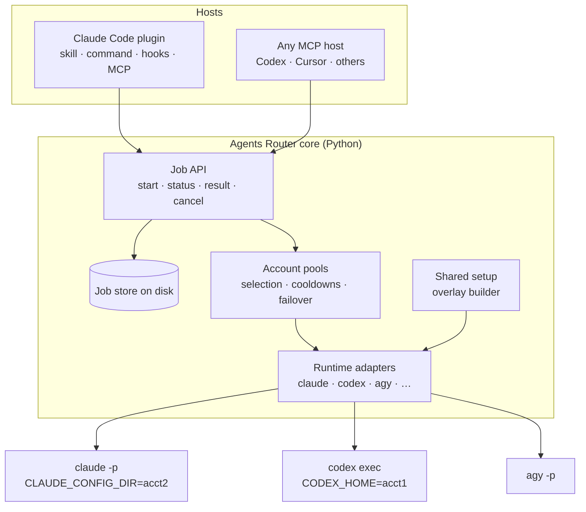

# Design and build plan

Updated 2026-10-14. Based on the research in [docs/research/](research/). The Claude Code, Codex and Antigravity runtimes (core, account pool, shared setup, failover, messages, plugin hooks) are implemented in v0.1 and were tested live on Windows; CI runs the suite on Windows, macOS and Linux. Items marked "Verified" were checked against a real `claude` 2.1.295.

## Goals

1. A main agent session (Claude Code first, then Codex, Cursor and any MCP host) can start subagents in other installed agent CLIs and collect their results.
2. A user with several subscriptions of one vendor gets one setup across all of them. MCP servers, plugins, skills, instructions and settings are defined once; only the login is per account.
3. Work can be spread across those accounts, and moved to another account when one is out of quota, where the vendor's terms allow it.
4. Authentication always stays inside the vendor's unmodified CLI. No proxy, no token handling.

Non-goals: making the main session's own model calls draw from other accounts (that needs a proxy, which is the design this project rejects), and supporting CLIs through screen scraping when a structured headless mode exists.

## The first use case

A developer has one Claude account for the main session and several more Claude Max accounts. Today they switch accounts by hand with separate `CLAUDE_CONFIG_DIR` folders, and every folder ends up with a different set of MCP servers and plugins.

With Agents Router:

- The main session (any client: terminal, desktop app, IDE) stays on its account and acts as the orchestrator.
- It delegates heavy or parallel work through the Agents Router tools. Each worker is a `claude -p` process running under one of the other accounts.
- Every worker sees the same MCP servers, plugins, skills and instructions as the main setup, without anything being maintained per account.
- When a worker's account reaches its limit, new work goes to an account with room left, if the user has enabled failover.

The main session's own usage is not pooled. Keeping it as a thin orchestrator and doing heavy work in workers is what makes the extra accounts useful. For interactive work, `agt launch` can open a normal session on whichever account has room, with the same shared setup.

## Architecture



### Core

One Python package with two front ends over the same functions:

- an MCP server (stdio) for every MCP host;
- an `agt` command-line helper. People can run it directly, and the Claude Code plugin hooks call it (`agt hook await`, `agt hook pending`).

Python because the existing adapter, its reviewer and tests are Python. The core uses only the standard library, including a small MCP server. The one dependency is rich (with rich-argparse for help), which only `ui.py` imports, and only to draw output for a person at a terminal; hooks, the MCP server and agents never load it.

### Job API

Every worker run is a job with an ID and its own folder (`spec.json`, `status.json`, `events.jsonl`, `result.md`), written atomically with private permissions. A detached runner process executes each job, so jobs survive restarts of the MCP server or the host, and a stale heartbeat with a dead runner marks the job `lost`.

| Tool | Purpose |
|---|---|
| `subagent_start` | Start a job: `runtime`, `prompt`, `cwd`, optional `account`, `model`, `effort`, `access` (`read`, `edit` or `full`), `max_turns`, `timeout_seconds`, `add_dirs`, `resume_job` |
| `subagent_wait` | Wait for any of several jobs to finish or send a message; up to an hour, or 240 s from a Codex host |
| `subagent_message` | Answer a question, send a follow-up to a running job, or continue a finished one as a new job |
| `subagent_status` | State and progress, with a short wait option so hosts don't poll in a tight loop |
| `subagent_result` | Final answer, outcome, session ID, cost, warnings (`max_chars` up to 80000) |
| `subagent_cancel` | Stop the job and its whole process tree |
| `subagent_list` | Recent jobs |
| `subagent_accounts` | Runtimes, accounts, login state, last known usage, cooldowns (no model calls) |

`subagent_start` and `subagent_status` take `wait_seconds` (up to 600, or 240 from a Codex host), so short jobs can be run and collected in one call.

### Messages and wake-ups

Each job folder has two append-only logs, `outbox.jsonl` (worker to main session) and `inbox.jsonl` (main session to worker), plus small files that record what each side has seen, so a message is shown once. A small built-in MCP server (`agt mcp --worker <job_id>`, named `agt-parent`) gives every worker three tools: `message_parent` (a note, no reply), `ask_parent` (a question that waits for the answer) and `check_parent_messages`.

For a Claude worker, a `PostToolUse` hook shows new follow-ups after the next tool call. Hook text is only a hint to the model, so anything the worker doesn't read explicitly is sent again by the runner as a follow-up turn (at most five).

On the main session's side the plugin's `hooks/hooks.json` has two hooks. An async `PostToolUse` hook on `subagent_start` and `subagent_message` runs `agt hook await`, which waits for the job and exits with code 2 so Claude Code wakes an idle session when the job finishes or the worker asks something. A `SessionStart` hook on resume and compact runs `agt hook pending`, which lists finished jobs in the project whose result nobody collected. Each result is delivered once: whichever of `subagent_wait`, `subagent_result` or the hook calls `claim_delivery` first gets it.

Results distinguish success, non-zero exit, timeout, cancellation, usage limit, auth failure and permission denial. "Produced some text" is never treated as success on its own; that is a known weakness of the current Antigravity adapter.

Recursion guard: workers get an environment depth counter (refused beyond `max_depth`) and this server's tools are removed from their tool list: `--disallowedTools` for Claude, `-c mcp_servers.<name>.enabled=false` for Codex.

### Runtime adapters

Each adapter implements: detect the binary and version, build the command and environment for a task and account, parse the event stream into common events, classify failures, and resume a native session.

| Runtime | Command | Events | Real read-only | Native reviewer |
|---|---|---|---|---|
| Claude Code | `claude -p --output-format stream-json --verbose` | `system/init`, assistant, tool, `api_retry`, `rate_limit_event`, `result` | `dontAsk` with read-only tools and shell prefixes; a worker `PreToolUse` hook checks shell options and named paths | auto mode (works in `-p`) |
| Codex | `codex exec --json` (app-server later for quota and live control) | `thread.*`, `turn.*`, `item.*` | `--sandbox read-only` | `--approve-for-me` |
| Antigravity | `agy --print --output-format stream-json --print-timeout` | JSON statuses, `denied_actions` | `--mode plan` | Agents Router' review gate (`agy_review`): a PreToolUse hook with fixed rules and a tool-less reviewer; edit jobs add `--sandbox` |

Permission levels are mapped per runtime instead of passing through raw flags: `read` maps to each CLI's real read-only mode (for Claude Code that is `dontAsk` plus an allowlist, because plan mode blocks every MCP call, including the channel to the main session); `edit` maps to accept-edits plus the native reviewer where one works headless (Claude auto mode, Codex `--approve-for-me`), or our reviewer where it doesn't. A bypass level exists only as an explicit per-call opt-in. The full table of CLIs and hooks is in [cli-permissions-and-headless.md](research/cli-permissions-and-headless.md).

## Account profiles and the shared setup

### Layout

```toml
# ~/.agt/settings.toml
[claude]
primary = "~/.claude"                 # the setup everyone shares
failover = "on-limit"                 # on-limit (default) | off
# max_jobs_per_account = 1            # default: no cap

[[claude.accounts]]
name = "max-2"
home = "~/.agents-router/homes/claude/max-2"

[[claude.accounts]]
name = "max-3"
home = "~/.agents-router/homes/claude/max-3"

[codex]
primary = "~/.codex"
failover = "on-limit"

[[codex.accounts]]
name = "plus-2"
home = "~/.agents-router/homes/codex/plus-2"
```

`agt accounts add max-2` creates the folder and opens the vendor's own CLI with that folder set, so the user logs in through the normal flow. The tool never reads the resulting credential file.

### Claude Code: inject the shared setup at launch

Each account folder holds only what must be per account: the login, the `.claude.json` state file (which caches the account identity, so it can't be shared), and session history. Everything else is passed to each `claude -p` run from the primary setup:

| Shared item | How it reaches the worker |
|---|---|
| User and local-scope MCP servers | `--mcp-config` with a file generated from the primary `.claude.json` (`mcpServers` plus the current project's local servers), plus the `agt-parent` entry |
| Settings, hooks, permissions, env | `--settings` overlay generated from the primary `settings.json`, without the keys in `DROP_SETTINGS` (`apiKeyHelper`, login-forcing keys, `enabledPlugins`, `extraKnownMarketplaces` and similar) and without auth-related `env` entries. The worker's inbox hook is added next to the user's own hooks |
| Installed plugins | `--plugin-dir` for each enabled user-scope plugin's folder in the primary plugin cache |
| `agents`, `commands`, `output-styles`, `rules`, `workflows` | One link per folder (junction on Windows, symlink elsewhere) |
| User skills | One link per skill, because Claude Code fills `skills/synced` per account |
| User `CLAUDE.md` | Hard-linked, so it is the same file on disk |
| Project memory (`projects/<project>/memory`) | Linked to the primary's memory folder for that project |

Every link or copy is tracked in `.agents-router-managed.json`, so names stay exactly as in the primary setup and later runs update or remove only what the sync created. Copies are a fallback for when the OS refuses a link.
| Project `.mcp.json`, project settings | already shared, because they live in the repository |

The adapter reads the `system/init` event of each run, and `agt doctor --live` compares the loaded MCP servers, plugins, skills and agents across accounts. It reports differences, for example a remote MCP server that needs a one-time OAuth login on one account.

Two things can't be shared:

- claude.ai connectors belong to each claude.ai account. Option A: set `connectors = "off"` so the overlay carries `disableClaudeAiConnectors` and every account sees exactly the same tools. Option B: add the same connectors on each account. Recommended: configure needed services as regular MCP servers in the primary setup.
- OAuth logins for remote MCP servers are stored per config folder. Run `agt launch --account <name>` and `/mcp` once.

A third limit comes from the Claude desktop app: tools built into the app itself (its browser and terminal panes, for example) belong to the app, not to your config, so CLI workers can't have them. Everything in your config folders and plugins is shared.

The environment of every worker is scrubbed of variables that identify or authenticate the host session (`ANTHROPIC_*`, `CLAUDE*`, host-side `CODEX_*` variables and similar), which would otherwise silently override the account's login.

### Codex: assemble the home before each run

Codex keeps MCP servers, plugins and settings in `config.toml` inside `CODEX_HOME`. Per account: `auth.json`, `sessions/`, the state database and logs. Shared: `config.toml`, `agents/`, `skills/`, `plugins/` and `AGENTS.md`. Before each run the adapter writes the primary `config.toml` into the account home, but keeps the account's own `[projects.*]`, `[hooks.state.*]` and `[notice.*]` tables, which Codex writes per home. `agents/` is linked as a whole (entry by entry if the account already has its own agents there), `skills/` and `plugins/` entries are linked one by one and `AGENTS.md` is hard-linked. Every command passes `cli_auth_credentials_store=file` so each login stays in its own folder. Secrets stay out of the shared `config.toml` (use `bearer_token_env_var`).

This tool's own MCP server is not removed from the copied config. Each Codex worker is started with `-c mcp_servers.<name>.enabled=false` for it, because Codex hands MCP servers a filtered environment and the depth counter never reaches a nested `agt mcp`. Names the config doesn't define get a stub command first, since Codex 0.162.1 refuses to load an `enabled=false` entry without a transport. Details in [codex-multi-account.md](research/codex-multi-account.md).

### Selection and failover

- An explicit `account` on a job always wins.
- Otherwise the pool skips accounts in cooldown and puts fallback accounts after regular accounts. Within each group, accounts below `usage_ceiling` (default 95%) come first, then the account that holds the conversation being continued, then the lowest reported utilization, then the one used least recently. With `when_full = "refuse"`, accounts at or above the ceiling get no new starts. A job waits up to 15 minutes for a busy slot.
- Limit detection for Claude: an error result that names a limit, together with a `rejected` `rate_limit_event` or HTTP 429, or the "hit your … limit" text. For Codex: an error message that mentions a usage limit. Codex usage comes from local rollout snapshots and ranks accounts by utilization, as for Claude.
- The cooldown ends at the first value available: a `Retry-After` in the error, the reset time the CLI reported, then `cooldown_minutes`; never more than 7 days. `agt accounts reset <name>` clears it.
- On a usage limit the job continues on another account: the Claude session transcript is copied into that account's folder and resumed (verified with Claude Code 2.1.295). Codex restarts with a handoff note containing the task and the partial output. A job pinned to one `account` doesn't fail over.
- `failover = "on-limit"` is the default for every runtime. Extra Antigravity accounts are at your own risk. `failover = "off"` turns switching off; for Antigravity it also keeps unpinned jobs on the primary account. See [provider-terms.md](research/provider-terms.md).

Concurrency: no cap on jobs per account folder by default. `.claude.json` has a history of corruption under concurrent writers, so `max_jobs_per_account = 1` brings back one running worker per account folder.

## Host packaging

| Host | Package |
|---|---|
| Claude Code | Plugin in this repository with `.claude-plugin/marketplace.json`: the usage skill, `/agents-router:delegate`, the MCP server and the two hooks in `hooks/hooks.json`. Install: `/plugin install agents-router --marketplace Watcharagorn/agents-router` |
| Codex | The same plugin manifest (`codex plugin add`), or an MCP server entry |
| Antigravity | `plugin.json` and `mcp_config.json` at the repository root, next to the shared skill |
| Cursor and other MCP hosts | MCP server entry, plus rules or skill text where the host supports it |

## Spikes before building

Each is a short experiment with real CLIs, recorded in `docs/research/` with the CLI version:

1. Verified: two account folders with the shared setup loaded identical plugins (6), skills (40) and agents (11) in `system/init`, including the user's own skills and agents and an installed plugin. Claude Code keeps account-synced skills in `skills/synced`, so shared skills are linked one by one instead of replacing the folder.
2. Verified: with `CLAUDE_CONFIG_DIR` set, the state file is `<dir>/.claude.json`; without it, `~/.claude.json`.
3. Partly verified: every run emits `rate_limit_event` with `status`, `utilization`, `resetsAt`, `rateLimitType` and `unifiedWindows.five_hour` / `seven_day`. The exact output at a real limit is still unobserved; detection uses `status: rejected`, HTTP 429 and the "hit your ... limit" text.
4. Verified: a session transcript copied into another account folder resumes there with its full history (a code word given on one account was recalled on the other). Failover and `resume_job` use this; the accounts in the test belonged to the same organization, so behaviour across organizations is still to be confirmed.
5. Partly open: `agents/` and the `skills/` and `plugins/` entries are linked into Codex account homes, but whether the real Codex follows junctions is not verified yet. `config.toml` is written as a file, not linked, because Codex may rewrite it. Verified with codex-cli 0.162.1: `-c mcp_servers.<name>.enabled=false` for a name the config doesn't define makes Codex refuse to load its config, which is why such names get a stub command.
6. Verified: AGY 1.3.5 on Windows streams `--output-format stream-json` through a plain pipe (`init`, `step_update` text deltas, `result` with `status` and `response`), so the core runtime needs no PTY. `--mode auto` reports "not available for this account" and falls back to `request-review`, so `edit` uses `accept-edits`.

7. Verified with a real Claude worker: two-way messages work (a worker's question reaches the main session and the answer comes back), and a follow-up sent to a running worker is applied.
8. Verified: a native Claude Code subagent and an Agents Router worker gave equivalent results on the same task.
9. Verified with 2.1.295: plan mode blocks MCP calls, including the parent channel, so `read` jobs use `dontAsk` with an allowlist instead.

Fixed after the fourth code review (covered by `tests/test_review_round4.py`):

- When `ask_parent` finds its answer, only that answer is marked read. A follow-up queued at the same time still reaches the worker through `check_parent_messages`, the worker's inbox hook or the runner's follow-up turn. Before, every unread inbox entry was marked read, so such a follow-up was lost.
- The wake-up hook runs again after `subagent_message`. `agt hook await` stops after it wakes the session for a question or a note, so before this nothing watched the rest of the job. Now answering a question starts a new watcher for the job, and a message to a finished job starts one for the new job (`new_job` in the reply). Only one watcher waits per job (`watch.lock` in the job folder), and only messages nobody has seen yet wake the session. A finished result is still claimed once with `claim_delivery`.
- Job slots are locked per account folder, not per account name. The lock path uses a hash of the resolved, case-normalized folder, so two names for the same folder share one set of slots. The owner record that keeps a slot busy after its runner died works as before.

Two findings from the live tests changed the design:

- A process started from inside a Claude Code session inherits about 35 of the host's variables, including `ANTHROPIC_BASE_URL`, the host's account and organization IDs, and `CLAUDE_CODE_PLUGIN_DIRS`. A worker would silently run through the host's gateway or account. Workers now start from a cleaned environment (`clean_environment` in `runtimes/base.py`).
- `--permission-mode auto` works in `-p` on a paid plan (`permissionMode: auto` in `system/init`), so `edit` jobs rely on Claude Code's own classifier instead of a reviewer of ours.

## Build order

| Phase | Scope | Done when |
|---|---|---|
| 0 | Repository cleanup, research | Done |
| 1 | Core job API and store, Claude adapter, Claude account profiles with the shared setup, `doctor` | Done; identical setup verified live on two account folders |
| 2 | Claude Code plugin and marketplace, usage skill | Done; the plugin loads its MCP server, skill and command in a live session |
| 3 | Failover (on by default), cooldowns, `subagent_accounts` | Done; tested with a fake CLI, a real limit not yet observed |
| 4 | Codex adapter and Codex account profiles | Done; live job on the primary Codex login, account sync and failover tested with a fake CLI |
| 5 | Antigravity runtime in the core | Done; live job through a plain pipe. Read and edit jobs run behind the review gate (2026-10-16) |
| 6 | Two-way messages, wake-up hooks, `agt wait` and `agt message` | Done; verified with a real Claude worker |
| 7 | Antigravity multi-account rotation | Implemented, on by default like the other runtimes and marked "use at your own risk", because Google's FAQ says consumer plans don't support automated account rotation; `failover = "off"` turns it off. Per-account HOME plus SSH-style variables give each folder its own file login. Not yet tested with a second real account |
| 8 | Cursor and further runtimes, compatibility matrix, CI | Each runtime has a recorded live test |

## Target layout

```text
src/agents_router/            config, accounts (pool), sync, jobs, runner, messages, hooks, hosts, tools, mcp_server, cli
src/agents_router/runtimes/   base.py (shared types, env cleaning), claude.py, codex.py, antigravity.py
.claude-plugin/               plugin.json and marketplace.json (the repository is the plugin)
hooks/hooks.json              Claude Code plugin hooks
plugin.json, mcp_config.json  Antigravity plugin
skills/agents-router/         usage skill
commands/                     /agents-router:delegate
tests/                        unit and end-to-end tests with fake claude, codex and agy CLIs
adapters/antigravity/         the original standalone AGY server (superseded by the review gate)
```

## Risks

- Terms: the vendors' restrictions target third-party token handling, which this project avoids; their terms don't address switching between your own CLI logins explicitly. Antigravity consumer plans rule out rotation, so extra Antigravity accounts are marked use at your own risk. Failover is on by default for every runtime and can be turned off per runtime.
- Vendor drift: flags, event formats and config layouts change often. `doctor` reports CLI versions but does not check compatibility.
- Concurrency bugs in vendor CLIs (`.claude.json`, credential refresh). Mitigated, when you opt in, by one job per account folder (`max_jobs_per_account = 1`).
- Windows: symlinks need developer mode; junctions don't, but only work for folders. Folder links use junctions there, and files are hard-linked or, on another drive, copied.
