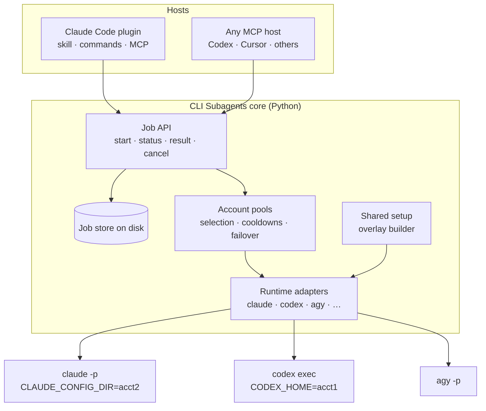

# Design and build plan

Updated 2026-10-14. Based on the research in [docs/research/](research/). The Claude Code part (core, account pool, shared setup, failover, plugin) and the Codex adapter are implemented in v0.1 and were tested live on Windows; CI runs the suite on Windows, macOS and Linux. Items marked "Verified" were checked against a real `claude` 2.1.295.

## Goals

1. A main agent session (Claude Code first, then Codex, Cursor and any MCP host) can start subagents in other installed agent CLIs and collect their results.
2. A user with several subscriptions of one vendor gets one setup across all of them. MCP servers, plugins, skills, instructions and settings are defined once; only the login is per account.
3. Work can be spread across those accounts, and moved to another account when one is out of quota, where the vendor's terms allow it.
4. Authentication always stays inside the vendor's unmodified CLI. No proxy, no token handling.

Non-goals: making the main session's own model calls draw from other accounts (that needs a proxy, which is the design this project rejects), and supporting CLIs through screen scraping when a structured headless mode exists.

## The first use case

A developer has one Claude account for the main session and several more Claude Max accounts. Today they switch accounts by hand with separate `CLAUDE_CONFIG_DIR` folders, and every folder ends up with a different set of MCP servers and plugins.

With CLI Subagents:

- The main session (any client: terminal, desktop app, IDE) stays on its account and acts as the orchestrator.
- It delegates heavy or parallel work through the CLI Subagents tools. Each worker is a `claude -p` process running under one of the other accounts.
- Every worker sees the same MCP servers, plugins, skills and instructions as the main setup, without anything being maintained per account.
- When a worker's account reaches its limit, new work goes to an account with room left, if the user has enabled failover.

The main session's own usage is not pooled. Keeping it as a thin orchestrator and doing heavy work in workers is what makes the extra accounts useful. For interactive work, `csa launch` can open a normal session on whichever account has room, with the same shared setup.

## Architecture



### Core

One Python package with two front ends over the same functions:

- an MCP server (stdio) for every MCP host;
- a `csa` command-line helper, which the Claude Code plugin calls through Bash for long jobs (the pattern OpenAI's Codex plugin uses to avoid MCP timeouts), and which people can run directly.

Python because the existing adapter, its reviewer and tests are Python. The core uses only the standard library, including a small MCP server, so installing it pulls in nothing else.

### Job API

Every worker run is a job with an ID and its own folder (`spec.json`, `status.json`, `events.jsonl`, `result.md`), written atomically with private permissions. A detached runner process executes each job, so jobs survive restarts of the MCP server or the host, and a stale heartbeat with a dead runner marks the job `lost`.

| Tool | Purpose |
|---|---|
| `subagent_runtimes` | Installed CLIs, versions, accounts and their health |
| `subagent_start` | Start a job: `runtime`, `prompt`, `cwd`, optional `account`, `model`, `effort`, `access` (`read` or `edit`), `timeout` |
| `subagent_status` | State, progress, and a short wait option so hosts don't poll in a tight loop |
| `subagent_result` | Final answer, changed files, session ID, usage, warnings |
| `subagent_cancel` | Stop the job and its whole process tree |
| `subagent_list` | Recent jobs |
| `subagent_accounts` | Runtimes, accounts, login state, last known usage, cooldowns (no model calls) |

`subagent_start` and `subagent_status` take `wait_seconds` (up to 600), so short jobs can be run and collected in one call.

Results distinguish success, non-zero exit, timeout, cancellation, usage limit, auth failure and permission denial. "Produced some text" is never treated as success on its own; that is a known weakness of the current Antigravity adapter.

Recursion guard: workers get an environment depth counter and the CLI Subagents tools are removed from their tool list (`--disallowedTools "mcp__cli_subagents__*"` for Claude).

### Runtime adapters

Each adapter implements: detect the binary and version, build the command and environment for a task and account, parse the event stream into common events, classify failures, and resume a native session.

| Runtime | Command | Events | Real read-only | Native reviewer |
|---|---|---|---|---|
| Claude Code | `claude -p --output-format stream-json --verbose` | `system/init`, assistant, tool, `api_retry`, `rate_limit_event`, `result` | `--permission-mode plan` | auto mode (works in `-p`) |
| Codex | `codex exec --json` (app-server later for quota and live control) | `thread.*`, `turn.*`, `item.*` | `--sandbox read-only` | `--approve-for-me` |
| Antigravity | `agy -p --output-format stream-json`, ConPTY fallback | JSON statuses, `denied_actions` | `--mode=plan` | Auto mode on macOS/Linux; our reviewer on Windows |

Permission levels are mapped per runtime instead of passing through raw flags: `read` maps to each CLI's real read-only mode; `edit` maps to accept-edits plus the native reviewer where one works headless (Claude auto mode, Codex `--approve-for-me`), or our reviewer where it doesn't. A bypass level exists only as an explicit per-call opt-in. The full table of CLIs and hooks is in [cli-permissions-and-headless.md](research/cli-permissions-and-headless.md).

## Account profiles and the shared setup

### Layout

```toml
# ~/.cli-subagents/config.toml
[claude]
primary = "~/.claude"                 # the setup everyone shares
failover = "off"                      # off | on-limit
max_jobs_per_account = 1

[[claude.accounts]]
name = "max-2"
home = "~/.cli-subagents/homes/claude/max-2"

[[claude.accounts]]
name = "max-3"
home = "~/.cli-subagents/homes/claude/max-3"

[codex]
primary = "~/.codex"
failover = "off"

[[codex.accounts]]
name = "plus-2"
home = "~/.cli-subagents/homes/codex/plus-2"
```

`csa accounts add claude max-2` creates the folder and opens the vendor's own CLI with that folder set, so the user logs in through the normal flow. The tool never reads the resulting credential file.

### Claude Code: inject the shared setup at launch

Each account folder holds only what must be per account: the login, the `.claude.json` state file (which caches the account identity, so it can't be shared), and session history. Everything else is passed to each `claude -p` run from the primary setup:

| Shared item | How it reaches the worker |
|---|---|
| User and local-scope MCP servers | `--mcp-config` with a file generated from the primary `.claude.json` (`mcpServers` plus the current project's local servers) |
| Settings, hooks, permissions, env | `--settings` overlay generated from the primary `settings.json`, without `apiKeyHelper`, login-forcing keys, `enabledPlugins`, `extraKnownMarketplaces` and auth-related `env` entries |
| Installed plugins | `--plugin-dir` for each enabled user-scope plugin's folder in the primary plugin cache |
| User skills, agents, commands, output styles, rules | Each entry is linked (folder: junction on Windows, symlink elsewhere) or copied (file) into the account folder and tracked in `.cli-subagents-managed.json`, so names stay exactly as in the primary setup |
| User `CLAUDE.md` | Copied into the account folder when it changes |
| Project `.mcp.json`, project settings | already shared, because they live in the repository |

Then the adapter reads the `system/init` event of each run and compares the loaded MCP servers and plugins with the primary setup. `csa doctor` reports differences, for example a remote MCP server that needs a one-time OAuth login on one account.

Two things can't be shared, and the docs say so:

- claude.ai connectors belong to each claude.ai account. Option A: set `disableClaudeAiConnectors` in the overlay so every account sees exactly the same tools. Option B: add the same connectors on each account. Recommended: configure needed services as regular MCP servers in the primary setup.
- OAuth logins for remote MCP servers are stored per config folder. `doctor` lists which account still needs `/mcp` once.

A link-based mode (junctions into each account folder, as clauth does) is the fallback if any injected item doesn't behave the same as the file-based version. The spikes below decide.

The environment of every worker is scrubbed of `ANTHROPIC_API_KEY`, `ANTHROPIC_AUTH_TOKEN`, `CLAUDE_CODE_OAUTH_TOKEN` and `CLAUDE_CODE_USE_*`, which would otherwise silently override the account's login.

### Codex: assemble the home before each run

Codex keeps MCP servers, plugins and settings in `config.toml` inside `CODEX_HOME`. Per account: `auth.json`, `sessions/`, the state database and logs. Shared: `config.toml`, `skills/`, `plugins/`, `AGENTS.md`. Before each run the adapter syncs the shared files into the account home (or links them if a spike shows Codex reads through junctions), with `cli_auth_credentials_store = "file"` so each login stays in its own folder. Secrets stay out of the shared `config.toml` (use `bearer_token_env_var`). Details in [codex-multi-account.md](research/codex-multi-account.md).

### Selection and failover

- An explicit `account` on a job always wins.
- Otherwise the pool picks the account with no active cooldown and the fewest running jobs, then the most remaining quota where the CLI reports it.
- Limit detection for Claude: `rate_limit_event` with `status: rejected`, `api_error_status` 429, `api_retry` with `error: rate_limit`, or the "hit your … limit · resets" text. For Codex: `turn.failed` or `error` with a usage message; remaining percentage from the app-server where available. The reset time becomes the account's cooldown.
- With `failover = "on-limit"`, a job that hit a limit is restarted on another account with a handoff note (the original task, what was done, the partial result). Resuming the same transcript under another account is not documented and stays off unless a spike proves it works.
- `failover` is off by default for every vendor and refused for Antigravity consumer plans. Turning it on shows the relevant terms. See [provider-terms.md](research/provider-terms.md).

Concurrency: one running worker per account folder by default, because `.claude.json` has a history of corruption under concurrent writers.

## Host packaging

| Host | Package |
|---|---|
| Claude Code | Plugin in this repository with `.claude-plugin/marketplace.json`: the usage skill, `/csa` commands, and the MCP server. Install: `/plugin marketplace add lunati228/CLI-Subagents` |
| Codex | MCP server entry plus the skill in the user's skill folder |
| Cursor and other MCP hosts | MCP server entry, plus rules or skill text where the host supports it |

## Spikes before building

Each is a short experiment with real CLIs, recorded in `docs/research/` with the CLI version:

1. Verified: two account folders with the shared setup loaded identical plugins (6), skills (40) and agents (11) in `system/init`, including the user's own skills and agents and an installed plugin. Claude Code keeps account-synced skills in `skills/synced`, so shared skills are linked one by one instead of replacing the folder.
2. Verified: with `CLAUDE_CONFIG_DIR` set, the state file is `<dir>/.claude.json`; without it, `~/.claude.json`.
3. Partly verified: every run emits `rate_limit_event` with `status`, `utilization`, `resetsAt`, `rateLimitType` and `unifiedWindows.five_hour` / `seven_day`. The exact output at a real limit is still unobserved; detection uses `status: rejected`, HTTP 429 and the "hit your ... limit" text.
4. Open: resuming a transcript under another account. Failover starts a new session with a handoff note instead.
5. Partly open: `skills/` and `plugins/` entries are linked into Codex account homes, but whether the real Codex follows junctions is not verified yet. `config.toml` is written as a file, not linked, because Codex may rewrite it.
6. Verified: AGY 1.3.5 on Windows streams `--output-format stream-json` through a plain pipe (`init`, `step_update` text deltas, `result` with `status` and `response`), so the core runtime needs no PTY. `--mode auto` reports "not available for this account" and falls back to `request-review`, so `edit` uses `accept-edits`.

Two findings from the live tests changed the design:

- A process started from inside a Claude Code session inherits about 35 of the host's variables, including `ANTHROPIC_BASE_URL`, the host's account and organization IDs, and `CLAUDE_CODE_PLUGIN_DIRS`. A worker would silently run through the host's gateway or account. Workers now start from a cleaned environment (`clean_environment` in `runtimes/base.py`).
- `--permission-mode auto` works in `-p` on a paid plan (`permissionMode: auto` in `system/init`), so `edit` jobs rely on Claude Code's own classifier instead of a reviewer of ours.

## Build order

| Phase | Scope | Done when |
|---|---|---|
| 0 | Repository cleanup, research | Done |
| 1 | Core job API and store, Claude adapter, Claude account profiles with the shared setup, `doctor` | Done; identical setup verified live on two account folders |
| 2 | Claude Code plugin and marketplace, usage skill | Done; the plugin loads its MCP server, skill and command in a live session |
| 3 | Failover (opt-in), cooldowns, `subagent_accounts` | Done; tested with a fake CLI, a real limit not yet observed |
| 4 | Codex adapter and Codex account profiles | Done; live job on the primary Codex login, account sync and failover tested with a fake CLI |
| 5 | Antigravity runtime in the core | Done; live job through a plain pipe. The standalone adapter stays for reviewed shell commands on Windows |
| 6 | Cursor and further runtimes, compatibility matrix, CI | Each runtime has a recorded live test |

## Target layout

```text
src/cli_subagents/            config, accounts (pool), jobs, runner, tools, mcp_server, cli
src/cli_subagents/runtimes/   base.py (shared types, env cleaning), claude.py, codex.py
.claude-plugin/               plugin.json and marketplace.json (the repository is the plugin)
skills/cli-subagents/         usage skill
commands/                     /cli-subagents:delegate
tests/                        unit and end-to-end tests with a fake claude
adapters/antigravity/         standalone AGY server until phase 5
```

## Risks

- Terms: failover at usage limits is a grey zone for Anthropic, at odds with OpenAI's rate-limit wording, and forbidden for Antigravity consumer plans. Mitigated by off-by-default and per-vendor gating, not removed.
- Vendor drift: flags, event formats and config layouts change often. Adapters check versions and `doctor` flags mismatches.
- Concurrency bugs in vendor CLIs (`.claude.json`, credential refresh). Mitigated by one job per account folder.
- Windows: symlinks need developer mode; junctions don't, but only work for folders. The overlay approach avoids most links.
